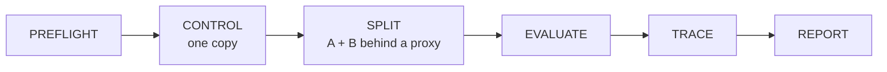

# How Twin works

- [The phases of a run](#the-phases-of-a-run)
- [What Twin touches](#what-twin-touches)
- [What Twin can't see](#what-twin-cant-see)
- [Supported languages](#supported-languages)

## The phases of a run

1. **PREFLIGHT** checks the scenario and `twin.config.json`, and refuses to run if your
   app is configured to use a real (non-local) database, because Twin writes real test
   data. See [SECURITY.md](../SECURITY.md).
2. **CONTROL** starts **one** throwaway copy of your app and runs the whole scenario
   against it. This proves the scenario works, so a later failure can't be a mistake in
   the scenario.
3. **SPLIT** starts **two** copies (A and B) behind Twin's own small proxy and runs the
   same scenario, sending each step to A or B as described in
   [Which copy a step goes to](scenarios.md#which-copy-a-step-goes-to).
4. **EVALUATE** compares the two runs. A check fails only when the same step passed in
   CONTROL.
5. **TRACE** looks through your code for the likely cause of each failure: known
   patterns first (a variable holding sessions, a local file write), then the files each
   copy actually changed on disk during the run.
6. **REPORT** prints the result, writes `report.md`, `report.json` and `results.json` to
   `.twin/runs/<id>/`, and exits `0`, `1` or `2`.

## What Twin touches

Twin copies your project into a temporary folder for each copy of your app, runs it
there, and deletes those folders afterwards. Your source files are never edited. What it
does change:

- **`.twin/`** in your project holds each run's reports and logs, plus a lock so two runs
  can't collide. `twin init` adds it to `.gitignore`.
- **Dependency folders are linked, not copied:** `node_modules`, a Python virtualenv
  (any folder with a `pyvenv.cfg`), Ruby's and PHP's `vendor`. So an app that writes into
  its own dependency folder while running writes into yours.
- **Your database** gets whatever the scenario writes. See
  [Your database keeps what a run writes](configuration.md#your-database-keeps-what-a-run-writes).
- **A `setup` command** runs in your project itself.
- **Go apps** are compiled once per run to one fixed file per project:
  `<cache>/twin/bin/<hash of the project path>/<folder name>`, where `<cache>` is
  `%LOCALAPPDATA%` on Windows, `~/Library/Caches` on macOS, and `$XDG_CACHE_HOME` or
  `~/.cache` elsewhere. One fixed path means Windows Firewall asks about it at most once.

Each copy gets a full copy of your project, three times per run. A very large project
folder (big data files, say) makes runs slow and uses that much disk space again,
temporarily. Run Twin from the folder that holds the app itself.

## What Twin can't see

**Both copies run on the same machine, so they share its disk.** An app that keeps data
in a file outside its own folder, like a hardcoded `/tmp/items.json` or a
`DATA_FILE=/home/me/data.json`, passes every check: both copies read and write the same
file. On two servers, each has its own file, and the app breaks.

Twin watches for this, but only partly:

- Each env value that is a full path on your machine gets a note saying both copies
  share it here and two servers wouldn't.
- During SPLIT, Twin watches those paths, plus data files directly inside the system
  temp folder. If anything there was written, every check that passed is reported as
  **NOT PROVEN** instead, and the run exits `2`, never `0`. Another program writing a
  data file in the temp folder at the same moment can cause this too.
- It can't see a hardcoded path elsewhere (`/var/lib/myapp/data.json`,
  `/tmp/myapp/data.json`). Keep data that production needs shared in a real shared store.

When a path really is shared in production, declare it with `{{shared}}` or
`sharedPaths` (see [Storage both copies share](configuration.md#storage-both-copies-share)).

**Twin can't see inside your database.** If both copies use the same database, data
written through one is visible through the other, which is correct.

**Only HTTP.** Scenarios send ordinary HTTP requests. WebSockets, server-sent event
streams, gRPC and background jobs aren't supported as steps.

**Some lost values aren't noticed.** A check compares the single-copy and two-copy
responses, but a field replaced by a different server-made value (`"role": "member"`
becoming `"anonymous"`) is only caught if the scenario itself sent or received the
original value.

## Supported languages

Twin talks to your app over HTTP, so it works with any language. What each language
adds is how to start the app, which folder to share between copies, and which code
patterns to suspect when a check fails.

| Language    | Detected by                                                  | Start command it guesses                                         | Shared, not copied                     |
| ----------- | ------------------------------------------------------------ | ---------------------------------------------------------------- | -------------------------------------- |
| **Node.js** | `package.json`                                               | `npm start`, `npm run dev` or `npm run serve`                    | `node_modules`                         |
| **Python**  | `requirements.txt`, `pyproject.toml`, `Pipfile`, `manage.py` | Django `runserver`, `uvicorn`, `flask run`, or the script itself | any virtualenv (a folder with `pyvenv.cfg`) |
| **Go**      | `go.mod`                                                     | `go run .`, compiled once per run                                | nothing (it's compiled)                |
| **Ruby**    | `Gemfile`, `config.ru` (or a lone `app.rb`, `server.rb` or `main.rb`)                  | `rails server`, `rackup`, or `ruby <script>`                     | `vendor`                               |
| **PHP**     | `composer.json`, `artisan`, `index.php`                      | `php artisan serve` or `php -S`                                  | `vendor`                               |

All five are tested in CI against real running apps, both ways: Twin fails a broken app
and passes a fixed one. Those apps are in [examples/](../examples/README.md).

**Node.js** uses the `start` script, then `dev`, then `serve`. If there are none but
exactly one other script, it uses that.

**Python** uses the project's own `.venv` or `venv` interpreter when there is one, since
that's where its packages are. For a virtualenv with another name, or outside the
project, put its interpreter in `--start`.

**Go** builds once before CONTROL, outside every start timeout, and starts each copy from
that file. A `start` or `build` of your own turns this off.

**When Twin can't tell**, it asks instead of guessing:

- `E_NO_STACK`: nothing it recognises. Pass `--start "<command>"`. If your app is in a
  subfolder, Twin names it: run Twin there.
- `E_AMBIGUOUS_STACK`: the folder looks like two languages (say `package.json` and
  `requirements.txt`). Say which one serves HTTP with `--stack python`.
